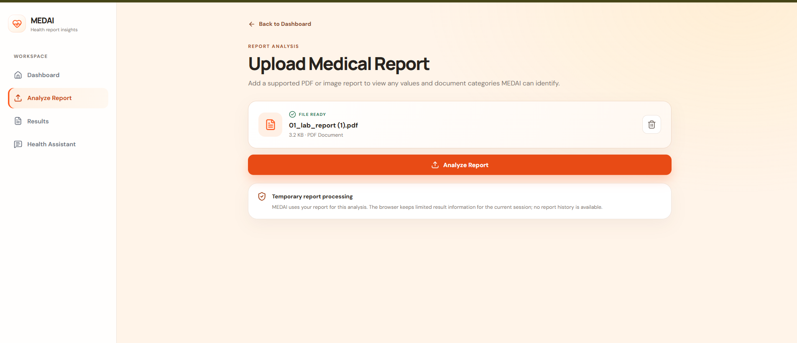
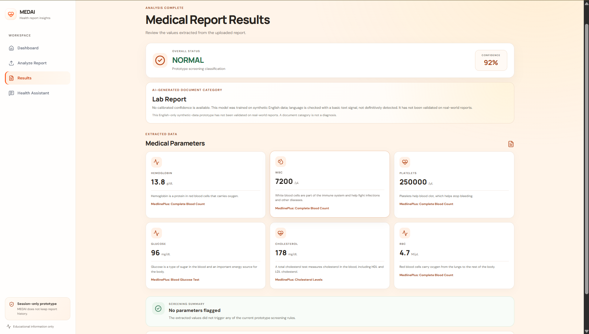
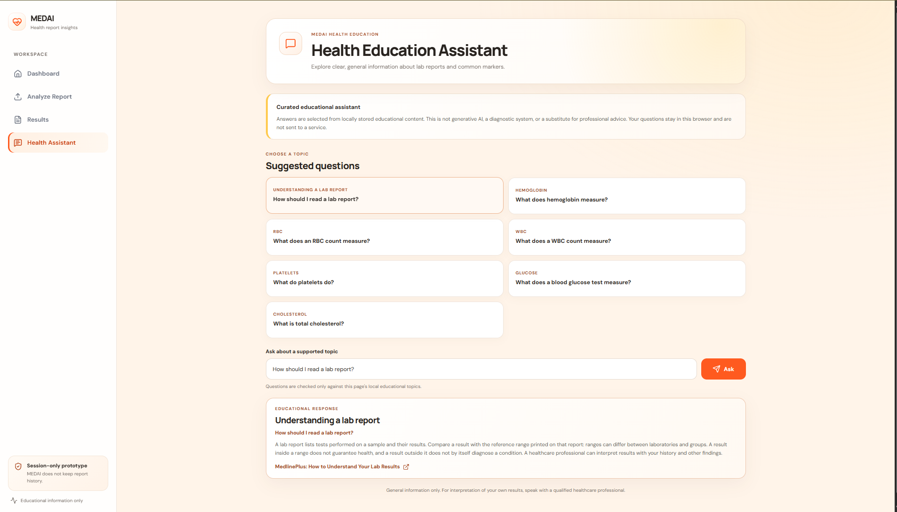
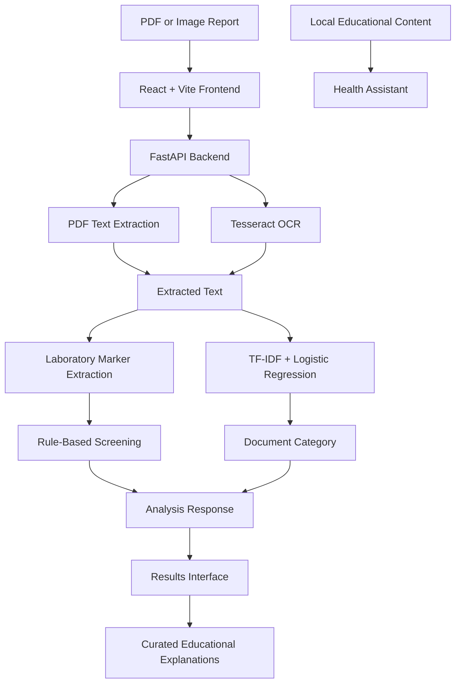

# MEDAI — AI-Based Medical Report Classification and Health Assistant

<p align="center">
  <strong>Making medical reports easier to understand through AI, document processing, and educational health information.</strong>
</p>

<p align="center">
  
  
  
  
  
</p>

<p align="center">
  <a href="https://github.com/UdaySthapak555/MEDAI">Repository</a> ·
  <a href="#features">Features</a> ·
  <a href="#architecture">Architecture</a> ·
  <a href="#installation-and-setup">Installation</a> ·
  <a href="#machine-learning-approach">Machine Learning</a>
</p>

---

## Overview

**MEDAI** is an educational AI/ML web application that helps users explore selected information from medical reports. It combines PDF processing, optical character recognition (OCR), laboratory marker extraction, rule-based screening, machine-learning document classification, and curated health education in one interface.

Users can upload supported reports, view recognized laboratory values, see a document category predicted by the ML model, and access educational explanations of selected health topics.

> **Medical disclaimer:** MEDAI is an educational prototype, not a medical diagnostic system. Its outputs are not confirmed medical findings and must not be used to make treatment decisions. Always consult a qualified healthcare professional for personal medical interpretation.

## Application Screenshots

### Dashboard


### Upload Medical Report



### Analysis Results



### Health Assistant



## Features

### Medical document processing
- Upload PDF, PNG, and JPEG reports.
- Select files or use drag-and-drop.
- Enforce a 10 MB upload limit and validate supported file types.
- Extract selectable PDF text using `pypdf`.
- Use Tesseract OCR for scanned PDF pages and images when correctly configured.

### Laboratory marker extraction
The current implementation recognizes six supported markers when their values and units can be interpreted:

| Marker | Description |
|---|---|
| Hemoglobin | Oxygen-carrying protein measurement |
| RBC | Red blood cell count |
| WBC | White blood cell count |
| Platelets | Blood components involved in clotting |
| Glucose | Blood sugar measurement |
| Total cholesterol | Measurement of total cholesterol |

Missing, conflicting, ambiguous, or unsupported values may remain unavailable rather than being guessed.

### Rule-based laboratory screening
The application applies predefined Python rules to supported laboratory values and displays one of three statuses:

- `NORMAL`
- `REVIEW`
- `ATTENTION`

These statuses describe the prototype's screening logic. They are not diagnoses, and the rules do not account for every person's circumstances or every laboratory's reference ranges.

### Machine-learning document classification
- Uses a TF-IDF feature pipeline and Logistic Regression.
- Predicts a document category from extracted text when input requirements are met.
- Keeps document categorization separate from laboratory marker screening.
- Uses a locally saved scikit-learn model artifact.

### Health education assistant
- Provides curated educational answers about report-reading basics and supported laboratory topics.
- Includes suggested questions and links to educational resources.
- Uses local educational content rather than an external generative AI service.
- Does not provide personalized diagnosis or treatment recommendations.

### Results and privacy-conscious design
- Displays available laboratory values, screening status, and document category.
- Shows educational explanations for supported markers.
- Temporarily stores a minimized analysis result in tab-scoped browser session storage.
- Does not intentionally persist the uploaded report text or original filename in that stored result.
- Does not provide persistent report history.

## Architecture



### Processing workflow

1. The user uploads a supported document through the React interface.
2. The frontend validates the file and sends it to the FastAPI backend.
3. The backend validates the upload and extracts readable text using PDF processing or OCR.
4. The extracted text is processed separately for laboratory marker extraction and document-type classification.
5. Python rules evaluate recognized laboratory values.
6. The ML pipeline predicts a document category when its input requirements are met.
7. The frontend displays available results and relevant educational content.

## Technology Stack

| Layer | Technologies |
|---|---|
| Frontend | React, Vite, JavaScript, React Router |
| UI | CSS, Lucide React |
| Backend | Python, FastAPI, Uvicorn |
| API communication | Axios |
| PDF extraction | pypdf |
| OCR preparation | pypdfium2, Pillow |
| OCR engine | Tesseract OCR |
| Machine learning | scikit-learn, TF-IDF, Logistic Regression |
| Model comparison | Linear SVC, majority-class baseline |
| Model serialization | joblib |
| Testing | Python `unittest`, Node.js built-in test runner |
| Version control | Git, GitHub |

## Machine Learning Approach

MEDAI contains two separate analysis mechanisms. They solve different problems and should not be interpreted as a single disease-prediction model.

### 1. Document-type classification

The document classifier uses TF-IDF text features with Logistic Regression to predict a document category. The local training experiment uses the supplied IndicPHI dataset, filters the data to English, and compares Logistic Regression and Linear SVC against a majority-class baseline.

The saved evaluation artifact reports these results on a synthetic English evaluation subset of 182 records:

| Model | Accuracy | Macro-F1 | Weighted-F1 |
|---|---:|---:|---:|
| Logistic Regression | 1.00 | 1.00 | 1.00 |
| Linear SVC | 1.00 | 1.00 | 1.00 |
| Majority-class baseline | 0.0714 | 0.0095 | See saved evaluation artifact |

**Interpretation:** These scores describe the supplied synthetic English evaluation subset only. They do not establish real-world clinical performance. The subset is small, some categories have limited evaluation support, and the model has not been validated on real medical reports or OCR-extracted clinical text.

The application does not provide a calibrated probability for the document category. Any separate confidence-like display must not be interpreted as validated medical confidence.

### 2. Rule-based laboratory screening

Laboratory screening is implemented using deterministic Python rules applied to recognized values. It is not a trained disease-prediction model.

| Status | Meaning in this prototype |
|---|---|
| `NORMAL` | Available values did not trigger the current screening rules. |
| `REVIEW` | Values are incomplete, ambiguous, or require further review. |
| `ATTENTION` | One or more values triggered a predefined screening rule. |

These labels do not establish whether a person is healthy or has a disease. Clinical interpretation depends on context, reference ranges, symptoms, and professional assessment.

## Project Structure

Simplified overview of the repository:

```text
MEDAI/
├── backend/
│   ├── main.py
│   ├── requirements.txt
│   ├── tests/
│   └── ...
├── frontend/
│   ├── src/
│   │   ├── components/
│   │   ├── pages/
│   │   └── utils/
│   ├── package.json
│   └── ...
├── docs/
├── screenshots/
│   ├── dashboard.png
│   ├── upload-report.png
│   ├── analysis-results.png
│   └── health-assistant.png
├── .gitignore
├── AGENTS.md
├── THIRD_PARTY_NOTICES.md
└── README.md
```

Local datasets, fitted model artifacts, browser review profiles, virtual environments, and other development-only files may be excluded from Git.

## Installation and Setup

### Prerequisites

Install:

- Git
- Node.js and npm
- Python compatible with `backend/requirements.txt`
- Tesseract OCR with English language data for scanned-document processing

If Tesseract is not available through `PATH`, configure its executable location using the supported `TESSERACT_CMD` setting.

### 1. Clone the repository

```powershell
git clone https://github.com/UdaySthapak555/MEDAI.git
cd MEDAI
```

### 2. Set up the backend

Open a PowerShell terminal at the project root:

```powershell
cd backend
py -m venv venv
.\venv\Scripts\python.exe -m pip install -r requirements.txt
.\venv\Scripts\python.exe -m uvicorn main:app --reload
```

The backend runs at:

- Health endpoint: `http://127.0.0.1:8000/`
- API documentation, if enabled: `http://127.0.0.1:8000/docs`

Keep this terminal running.

### 3. Set up the frontend

Open a second PowerShell terminal at the project root:

```powershell
cd frontend
npm ci
npm run dev
```

Open the local URL printed by Vite, normally `http://localhost:5173`.

Keep both servers running while using MEDAI.

### Model artifact availability

The document classifier expects a local saved artifact under `backend/artifacts/indicphi_document_type/`. Model artifacts and raw datasets may be excluded from the public repository. If the required artifact is unavailable after cloning, document categorization may be unavailable until the model is obtained or reproduced using the project's documented, licensed training process.

## API Endpoints

| Method | Endpoint | Purpose |
|---|---|---|
| `GET` | `/` | Basic API health response |
| `POST` | `/api/upload` | Validate an upload and return metadata |
| `POST` | `/api/analyze` | Extract report content and return available analysis results |

The POST endpoints accept multipart form data using the field name `file`. The upload limit is 10 MB.

## Testing

Run the backend test suite from the `backend` directory:

```powershell
.\venv\Scripts\python.exe -m unittest discover -s tests -v
```

Run frontend utility tests from the `frontend` directory:

```powershell
node --test src/utils/analysisStorage.test.js src/utils/uploadValidation.test.js
```

Run ESLint:

```powershell
npm run lint
```

Run the frontend production build:

```powershell
npm run build
```

The latest reported verification recorded 68 passing backend tests and 9 passing frontend utility tests, with ESLint and the production build also passing. Re-run the commands to verify any subsequent changes.

Use synthetic reports for tests and demonstrations. Do not include real patient reports in test fixtures.

## Limitations

- Only six laboratory markers are currently supported.
- Extraction depends on document layout, OCR quality, recognized units, and supported formats.
- Document classification is limited by its training data and English-input requirements.
- Synthetic evaluation scores are not evidence of real-world clinical accuracy.
- The model has not been validated on real reports or OCR output.
- Rule-based flags are not diagnoses.
- The Health Assistant uses curated educational content rather than unrestricted generative AI.
- The application does not prescribe medicines or provide personalized treatment.
- MEDAI is an educational prototype and is not intended for clinical deployment.

## Privacy and Security

Medical reports may contain sensitive personal information.

- Use synthetic or appropriately de-identified reports for demonstrations and testing.
- Never commit patient records, credentials, API keys, or `.env` files.
- Keep local datasets, model artifacts, and development-only browser profiles out of Git unless they have been intentionally reviewed for publication.
- The backend processes report contents in memory and does not intentionally create a persistent report copy.
- The frontend temporarily stores a minimized result in browser session storage.
- In-memory processing and session storage do not guarantee secure deletion.
- Review dataset and upstream licensing terms before redistributing data or model artifacts.

## Future Improvements

Potential future improvements include:

- Evaluation on appropriately licensed, representative real-world or de-identified reports.
- More robust text extraction across varied report layouts and OCR quality.
- Expanded marker support with suitable validation.
- More automated browser end-to-end testing.
- Reproducible model training and evaluation workflows.
- Security, accessibility, and deployment reviews before wider use.

These are proposed improvements, not claims about current functionality.

## Author

**Uday Sthapak**

- GitHub: [@UdaySthapak555](https://github.com/UdaySthapak555)
- Project repository: [MEDAI](https://github.com/UdaySthapak555/MEDAI)

---

<p align="center">
  Built as an educational AI/ML project exploring OCR, NLP, document classification, and accessible health information.
</p>